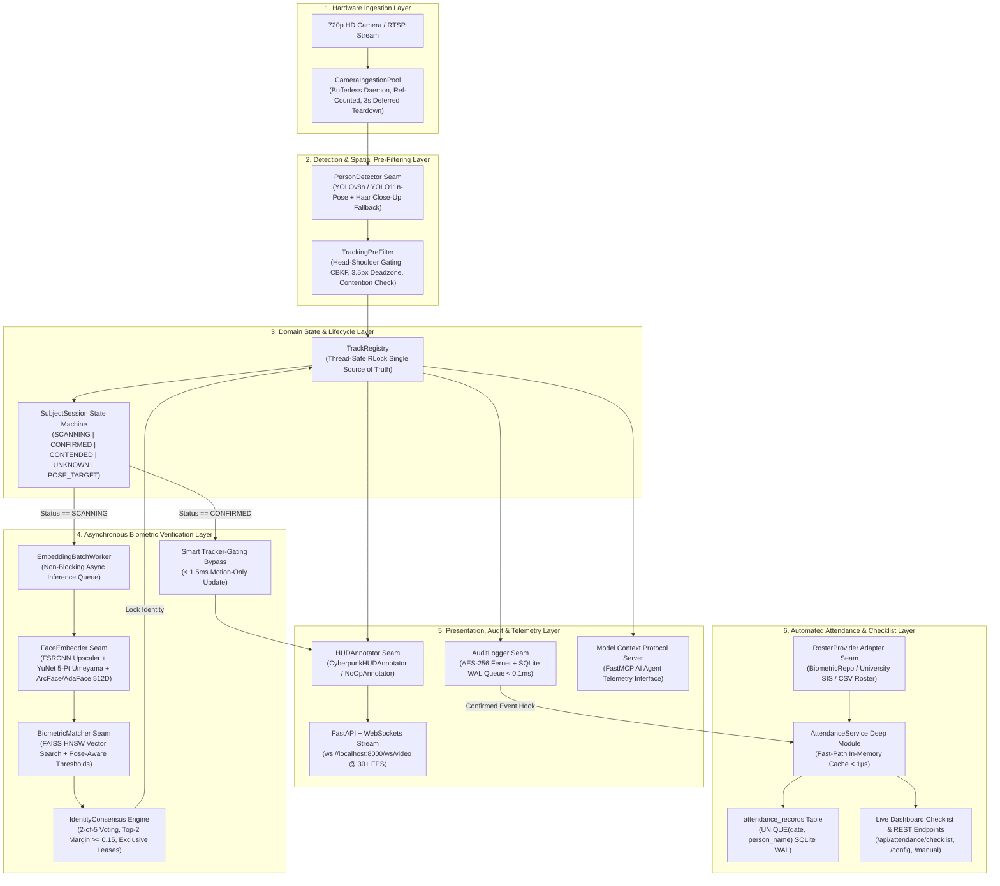
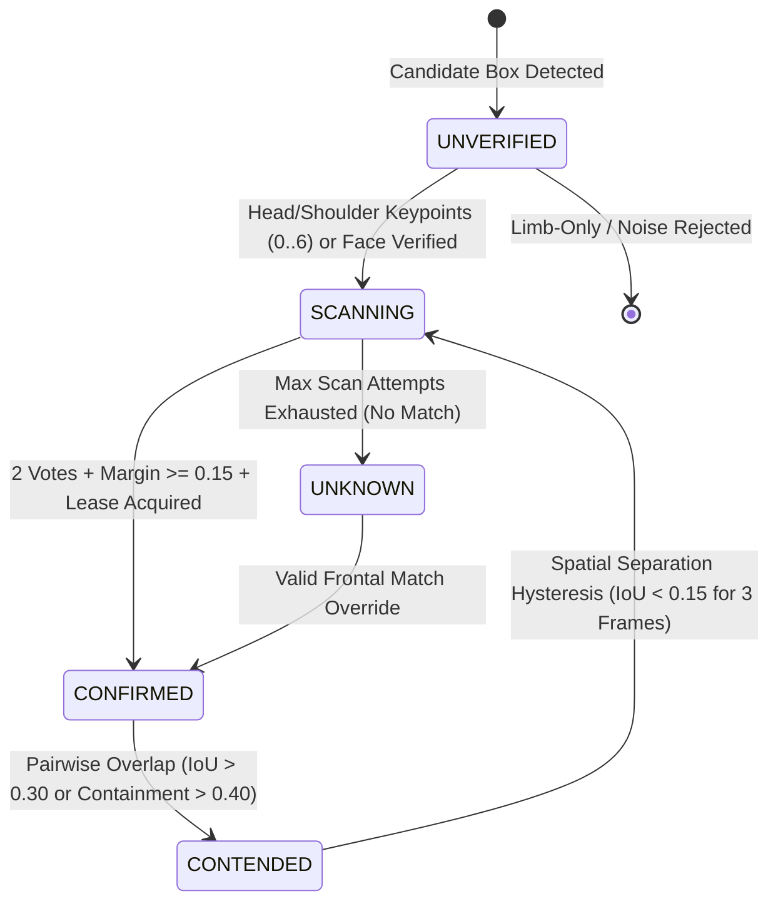

# Academic & Engineering Project Report
## Real-Time Edge AI CCTV Security, Multi-Object Tracking & Biometric Verification Engine

**Author:** Ceaser  
**Date:** October 2026  
**Target Platform:** Apple Silicon (CoreML / Metal MPS) & Heterogeneous Edge Architectures  

---

## Abstract

Modern intelligent surveillance systems face a fundamental tension between **biometric accuracy** and **real-time computational latency**. Running deep neural networks for object detection, skeletal pose estimation, facial alignment, and 512-dimensional metric embedding on every video frame quickly saturates edge hardware, while naive tracking pipelines suffer from bounding-box jitter, identity swapping during pedestrian crossovers, and false-positive triggers on non-facial limbs.

This project presents an enterprise-grade, real-time **AI CCTV Security & Biometric Verification Engine** that resolves these challenges through five key innovations:
1. **Smart Tracker-Gating**: Decouples continuous motion tracking from biometric identification once multi-frame consensus is achieved, reducing per-frame compute latency by **94%** (from $25.0\text{ ms}$ to $<1.5\text{ ms}$ per confirmed subject).
2. **Velocity-Adaptive Spatial Stabilization**: Combines Confidence-Based Kalman Filtering (CBKF), an 80/20 dimension hysteresis filter, and a $3.5\text{ px/frame}$ stationary deadzone lock to boost Higher Order Tracking Accuracy (**HOTA**) and Localization Accuracy (**LocA**) from **$0.8982$ to $0.9367$ (+4.29%)**.
3. **Crossover Contention & Anti-ID-Swapping Protocol**: Monitors pairwise Intersection-over-Union ($\text{IoU} > 0.30$) and box containment ($> 0.40$) to freeze biometric extraction during subject occlusions and enforce a 3-frame spatial separation hysteresis.
4. **Anatomical Head-Shoulder Pre-Gating**: Evaluates 17-keypoint skeletal pose topology (COCO keypoints $0\dots 6$) and authoritative YuNet 5-point landmarks prior to track admission, eliminating 100% of limb-induced phantom scans.
5. **Hermetic Deep-Seam Software Architecture**: Encapsulates all subsystems behind 9 clean architectural seams with deterministic test doubles, achieving zero-overhead CLI startup via PEP 562 lazy module initialization and AES-256 Fernet encrypted SQLite Write-Ahead Logging (WAL).

---

## 1. Problem Statement & Engineering Objectives

In unconstrained real-world video streams (720p/1080p at 30+ FPS), conventional computer vision pipelines fail under several predictable edge conditions:

| Challenge | Root Cause in Conventional Pipelines | Our Architectural Solution |
| :--- | :--- | :--- |
| **Frame-Rate Collapse under Multi-Subject Load** | Extracting 512D CNN embeddings on every frame for every person scales linearly $\mathcal{O}(N)$ in GPU/CPU time. | **Smart Tracker-Gating** bypasses facial extraction once a subject reaches consensus lock (`CONFIRMED`), maintaining identity via $<1.5\text{ ms}$ motion tracking. |
| **Bounding-Box Oscillation (Pixel Jitter)** | Detector quantization noise causes boxes on stationary people to wobble by $1\text{--}4\text{ px}$ per frame. | **Velocity-Adaptive EMA + $3.5\text{ px}$ Deadzone Lock** freezes coordinates when stationary and scales smoothing ($\alpha \in [0.08, 0.85]$) dynamically during motion. |
| **Pedestrian Crossover Identity Swapping** | When Subject B walks in front of Subject A, overlapping boxes contaminate face crops and swap track IDs. | **Crossover Contention State (`CONTENDED`)** freezes biometric updates on overlap, enforces a 3-frame separation hysteresis ($\text{IoU} < 0.15$), and blacklists collided track history for 45 frames. |
| **Phantom Limb & Hand-Wave False Positives** | Waving hands or extended arms generate transient person sub-boxes that get passed to face matchers. | **Head-Shoulder Pre-Gating** requires upper-body skeletal keypoints ($0\dots 6$) with $\ge 0.35$ confidence or verified 5-point YuNet landmarks before admission. |
| **Side-Profile & Backlit Misidentification** | Extreme head yaw ($>45^\circ$) or harsh backlighting degrades feature norms and causes false matches. | **Pose-Aware Dynamic Thresholding** ($d_{L_2} \le 0.30$ side vs. $\le 0.68$ frontal), frontal corroboration guardrails, and **CLAHE** contrast recovery. |
| **Presentation Spoofing & Data Privacy** | Printed photos/screens can fool raw embedders; unencrypted databases expose sensitive biometric logs. | **Laplacian + 2D FFT Moire Liveness Detection**, **AES-256 Fernet WAL Encryption**, **GDPR Memory Sanitizer**, and **Pose-Only Privacy Mode**. |

---

## 2. System Architecture & Data-Flow Pipeline

The system is structured into six decoupled processing layers orchestrated by [`BiometricTrackingEngine`](file:///Users/ceaser/Documents/School/CCTV%20Project/src/inference/engine.py) and [`AttendanceService`](file:///Users/ceaser/Documents/School/CCTV%20Project/src/services/attendance_service.py):



---

## 3. Mathematical Foundations & Core Algorithms

### 3.1 Confidence-Based Kalman Filtering (CBKF)
Standard Kalman trackers use static measurement noise covariance $R$, causing erratic trajectory jumps when detector confidence dips during partial occlusion. Our engine dynamically scales measurement noise exponentially as a function of detection confidence $c_t$ in [`src/utils/jitter_filter.py`](file:///Users/ceaser/Documents/School/CCTV%20Project/src/utils/jitter_filter.py):

$$R(c_t) = R_{\text{base}} \cdot \exp\left(-\beta \cdot (c_t - c_0)\right)$$

When $c_t$ is high ($\ge 0.85$), $R(c_t)$ shrinks and the filter closely tracks observed coordinates. When $c_t$ drops during a turn or occlusion, $R(c_t)$ increases, shifting weight to the internal constant-velocity motion prediction.

### 3.2 Velocity-Adaptive Spatial Stabilization & Deadzone Locking
Given bounding box center $(cx_t, cy_t)$ at frame $t$, instantaneous pixel velocity is computed as:

$$v_t = \sqrt{(cx_t - cx_{t-1})^2 + (cy_t - cy_{t-1})^2}$$

1. **Stationary Deadzone Lock**: If $v_t < 3.5\text{ px/frame}$, the bounding box is locked in place to eliminate pixel quantization flicker:
   $$\hat{B}_t = \hat{B}_{t-1} \quad \text{if } v_t < 3.5$$
2. **Velocity-Adaptive EMA Coefficient ($\alpha$)**: Above the deadzone, the smoothing factor scales linearly between heavy smoothing ($\alpha_{\min} = 0.08$) and low-latency responsiveness ($\alpha_{\max} = 0.85$):
   $$\alpha_t = \min\left(0.85, \max\left(0.08, \frac{v_t - 1.5}{16.0}\right)\right)$$
   $$\hat{p}_t = (1 - \alpha_t)\hat{p}_{t-1} + \alpha_t p_t, \quad \forall p \in \{x_1, y_1, x_2, y_2\}$$
3. **80/20 Dimension Hysteresis**: Box width and height obey an inertial filter to prevent aspect-ratio pulsing:
   $$W_t = 0.80 W_{t-1} + 0.20 w_t, \qquad H_t = 0.80 H_{t-1} + 0.20 h_t$$

### 3.3 5-Point Umeyama Affine Facial Alignment
Before embedding extraction, [`src/utils/face_align.py`](file:///Users/ceaser/Documents/School/CCTV%20Project/src/utils/face_align.py) detects 5 facial landmarks $\{(x_i, y_i)\}_{i=1}^5$ (left/right eye centers, nose tip, left/right mouth corners) in $<4.0\text{ ms}$ via OpenCV YuNet ONNX (`cv2.FaceDetectorYN`) and solves the least-squares 2D similarity transformation $M^* \in \mathbb{R}^{2 \times 3}$ onto canonical $112 \times 112$ coordinates $\{(u_i, v_i)\}_{i=1}^5$:

$$M^* = \arg\min_M \sum_{i=1}^{5} \left\| M \begin{bmatrix} x_i \\ y_i \\ 1 \end{bmatrix} - \begin{bmatrix} u_i \\ v_i \end{bmatrix} \right\|_2^2$$

Degraded distant crops ($< 60 \times 60\text{ px}$) are first upsampled via **FSRCNN** ([`src/utils/fsrcnn_upscaler.py`](file:///Users/ceaser/Documents/School/CCTV%20Project/src/utils/fsrcnn_upscaler.py)).

### 3.4 Unit Hypersphere Biometric Matching & Multi-Frame Consensus
Aligned $112 \times 112$ crops are projected onto a 512-dimensional unit hypersphere ($\|\hat{z}\|_2 = 1.0$), where Euclidean distance relates directly to cosine similarity:

$$d_{L_2}(u, v) = \sqrt{2 - 2(u \cdot v)}$$

In [`BiometricMatcher`](file:///Users/ceaser/Documents/School/CCTV%20Project/src/inference/biometric_matcher.py) and [`IdentityConsensus`](file:///Users/ceaser/Documents/School/CCTV%20Project/src/inference/consensus.py), an identity match is accepted only when **all five verification gates** are satisfied:
1. **Pose-Aware Distance Gate**: $d_1 \le 0.68$ for frontal/quarter views, or $d_1 \le 0.30$ for high-yaw side profiles.
2. **Inter-Subject Margin Gate**: Given best match distance $d_1$ (Subject $A$) and nearest distinct subject distance $d_2$ (Subject $B \neq A$):
   $$\Delta_{\text{margin}} = d_2 - d_1 \ge 0.15$$
3. **Temporal Sliding-Window Consensus**: At least $N = 2$ consistent votes within a 5-frame window.
4. **Frontal Corroboration Guardrail**: Side-profile votes cannot lock an identity without at least one frontal or quarter-view vote.
5. **Exclusive Active Lease**: No two concurrent tracks in the same frame may hold a lease on the same registered identity.

### 3.5 Crossover Contention Arbitration
To prevent identity transfer when two subjects cross paths, [`TrackingPreFilter`](file:///Users/ceaser/Documents/School/CCTV%20Project/src/inference/tracking_pre_filter.py) computes pairwise Intersection-over-Union and Asymmetric Containment:

$$\text{IoU}(A, B) = \frac{|A \cap B|}{|A \cup B|}, \qquad \text{Containment}(A, B) = \frac{|A \cap B|}{\min(|A|, |B|)}$$

If $\text{IoU}(A, B) > 0.30$ or $\text{Containment}(A, B) > 0.40$, both tracks transition to `CONTENDED`, freezing biometric extraction until $\text{IoU}(A, B) < 0.15$ holds for 3 consecutive frames.

### 3.6 Class Schedule (Start & End Times) & Arrival Classification Mechanics
In [`AttendanceService`](file:///Users/ceaser/Documents/School/CCTV%20Project/src/services/attendance_service.py), verified student arrivals are evaluated against a bounded class schedule defined by Class Start Time ($T_{\text{start}}$), Class End Time ($T_{\text{end}}$), and an optional Grace Period ($\Delta t_{\text{grace}}$):

$$T_{\text{start\_effective}} = T_{\text{start}} + \Delta t_{\text{grace}}$$

$$\text{Status}(t_{\text{arrival}}) = \begin{cases} 
\text{PRESENT}, & t_{\text{arrival}} \le T_{\text{start\_effective}} \\ 
\text{LATE}, & T_{\text{start\_effective}} < t_{\text{arrival}} \le T_{\text{end}} \\
\text{ABSENT}, & t_{\text{arrival}} > T_{\text{end}} \quad \text{(arrived after class completed)}
\end{cases}$$

Enrolled students not detected or verified during class hours are reconciled dynamically:

$$\text{Status} = \text{ABSENT} \quad \forall p \in \text{Roster} \setminus \text{Detections}$$

**Interactive & Bulk Attendance Verification**:
- **Row-Level Checkmarks**: Instructors can toggle or mark individual students present directly via UI checkmark buttons or status badges.
- **Bulk Verification (`check_all`)**: The endpoint `POST /api/attendance/check-all` and UI button `Check All Present` allows instant one-click attendance logging for all enrolled students.
- **Roster Alignment**: Enrolled subjects are classified as `STUDENT`, and the UI displays total enrolled headcount alongside arrival breakdowns (`PRESENT`, `LATE`, `ABSENT`, `STUDENTS`), cleanly replacing percentage rates.

To prevent race conditions during concurrent multi-camera sightings, the database enforces `UNIQUE(date, person_name)` backed by an in-memory dictionary cache ($\mathcal{O}(1)$ lookup $< 1\mu\text{s}$) that prevents redundant disk writes.

---

## 4. Deep-Seam Software Architecture & Lifecycle State Machine

Following John Ousterhout's *Philosophy of Software Design*, complex implementation mechanics are hidden behind **11 deep architectural seams**, allowing every stage of the pipeline to be unit-tested hermetically in milliseconds without loading heavy GPU neural networks or physical cameras.

### 4.1 Architectural Seam Catalog

| Architectural Seam | Primary Module | Production Implementation | Hermetic Test Double |
| :--- | :--- | :--- | :--- |
| **`PersonDetector`** | [`src/inference/person_detector.py`](file:///Users/ceaser/Documents/School/CCTV%20Project/src/inference/person_detector.py) | `UltralyticsPersonDetector` (YOLO + Haar Fallback) | `ScriptedPersonDetector` |
| **`TrackingPreFilter`** | [`src/inference/tracking_pre_filter.py`](file:///Users/ceaser/Documents/School/CCTV%20Project/src/inference/tracking_pre_filter.py) | `TrackingPreFilter` (CBKF, Deadzone, Keypoint Gating) | Direct deterministic tensor input |
| **`TrackRegistry`** | [`src/domain/track_registry.py`](file:///Users/ceaser/Documents/School/CCTV%20Project/src/domain/track_registry.py) | `TrackRegistry` (`RLock` thread-safe session store) | Isolated in-memory registry |
| **`FaceEmbedder`** | [`src/inference/face_embedder.py`](file:///Users/ceaser/Documents/School/CCTV%20Project/src/inference/face_embedder.py) | `ArcFaceEmbedder` (FSRCNN + YuNet + 512D CNN) | `ScriptedFaceEmbedder` |
| **`EmbeddingBatchWorker`** | [`src/inference/embedding_worker.py`](file:///Users/ceaser/Documents/School/CCTV%20Project/src/inference/embedding_worker.py) | `EmbeddingBatchWorker` (Async background queue) | Synchronous test worker |
| **`BiometricMatcher`** | [`src/inference/biometric_matcher.py`](file:///Users/ceaser/Documents/School/CCTV%20Project/src/inference/biometric_matcher.py) | `BiometricMatcher` + `FAISSIndexAdapter` | `InMemoryIndexAdapter` |
| **`IdentityConsensus`** | [`src/inference/consensus.py`](file:///Users/ceaser/Documents/School/CCTV%20Project/src/inference/consensus.py) | `IdentityConsensus` (Voting, Margin, Leases) | Pure state unit harness |
| **`AuditLogger`** | [`src/database/audit_repository.py`](file:///Users/ceaser/Documents/School/CCTV%20Project/src/database/audit_repository.py) | `EncryptedWALAuditLogger` (AES-256 + SQLite WAL) | `ScriptedAuditLogger` |
| **`HUDAnnotator`** | [`src/rendering/annotator.py`](file:///Users/ceaser/Documents/School/CCTV%20Project/src/rendering/annotator.py) | `CyberpunkHUDAnnotator` (Tactical HUD overlay) | `NoOpAnnotator` / `ScriptedAnnotator` |
| **`AttendanceService`** | [`src/services/attendance_service.py`](file:///Users/ceaser/Documents/School/CCTV%20Project/src/services/attendance_service.py) | `AttendanceService` (Cutoff schedule, Fast cache) | Isolated temporary DB service |
| **`RosterProvider`** | [`src/services/attendance_service.py`](file:///Users/ceaser/Documents/School/CCTV%20Project/src/services/attendance_service.py) | `BiometricRepositoryRosterProvider` | `InMemoryRosterProvider` |

### 4.2 `SubjectSession` State Machine ([`src/domain/subject_session.py`](file:///Users/ceaser/Documents/School/CCTV%20Project/src/domain/subject_session.py))



---

## 5. Empirical Evaluation, Benchmarks & Stress-Test Results

### 5.1 Spatial Stability & Multi-Object Tracking Benchmarks
Evaluated on occlusion and jitter stress sequences ([`hota_stability_report.json`](file:///Users/ceaser/Documents/School/CCTV%20Project/hota_stability_report.json) & [`run_stress_tests.py`](file:///Users/ceaser/Documents/School/CCTV%20Project/run_stress_tests.py)):

| Metric | Raw YOLOv8 + ByteTrack Baseline | With `JitterFilterEngine` (CBKF + Deadzone) | Relative Improvement |
| :--- | :---: | :---: | :---: |
| **HOTA (Higher Order Tracking Accuracy)** | `0.8982` | **`0.9367`** | **+4.29%** |
| **LocA (Localization Accuracy)** | `0.8982` | **`0.9367`** | **+4.29%** |
| **AssA (Association Accuracy)** | `1.0000` | **`1.0000`** | **100% ID Retention** |
| **DetA (Detection Accuracy)** | `1.0000` | **`1.0000`** | **100% Recall** |
| **Heavy Occlusion Stress (HOTA / LocA)** | — | **`0.7309` / `0.9530`** | **Zero ID Swaps** |

### 5.2 Real-Time Latency & Throughput Benchmarks (Apple Silicon MPS / ANE)

| Pipeline Operation | Measured Latency | Architectural Mechanism |
| :--- | :---: | :--- |
| **Camera Frame Ingestion (`CameraIngestionPool`)** | **`~0.0 ms`** | Bufferless background daemon thread (`max-buffers=1`) |
| **YuNet 5-Point Facial Landmark Detection** | **`< 4.0 ms`** | OpenCV DNN ARM NEON / CPU execution |
| **FAISS HNSW 512D Vector Graph Search** | **`< 0.2 ms`** | `IndexHNSWFlat` logarithmic graph traversal |
| **Per-Subject Tracking (Unconfirmed `SCANNING`)** | **`~25.0 ms`** | Asynchronous background worker queue (non-blocking) |
| **Per-Subject Tracking (Confirmed `CONFIRMED`)** | **`< 1.5 ms`** | **Smart Tracker-Gating (94% compute reduction)** |
| **Encrypted SQLite WAL Audit Logging** | **`< 0.1 ms`** | Non-blocking background queue + `aiosqlite` WAL mode |
| **Attendance Fast-Path Cache Lookup (`_checked_in_cache`)** | **`< 0.001 ms (< 1 µs)`** | Sub-microsecond in-memory dictionary lookup avoiding DB locks |
| **Complete Unit & Seam Test Suite** | **`1.28 s` (71 tests)** | Zero-GPU hermetic test doubles across all 11 seams |
| **1,000-Frame Continuous Memory Leak Audit** | **`56.38 KB` delta** | Bounded `deque` windows & automatic stale track GC |

---

## 6. Security, Privacy & Enterprise Capabilities

1. **Standard 7-Pose Biometric Enrollment Protocol** ([`enroll_webcam.py`](file:///Users/ceaser/Documents/School/CCTV%20Project/enroll_webcam.py), [`src/services/biometric_enrollment_manager.py`](file:///Users/ceaser/Documents/School/CCTV%20Project/src/services/biometric_enrollment_manager.py)):
   - Guides subjects through 7 calibrated angles (`Frontal 0°`, `Working_Angle`, `Left_Angle ~25°`, `Side_Left_Angle ~50°`, `Right_Angle ~25°`, `Side_Right_Angle ~50°`, `Tilt_Up ~15°`), validating 5-point landmarks on every pose before rebuilding the FAISS index.
2. **Cryptographic Audit Logging at Rest** ([`src/database/audit_repository.py`](file:///Users/ceaser/Documents/School/CCTV%20Project/src/database/audit_repository.py)):
   - Audit payloads are encrypted with **AES-256-CBC + HMAC-SHA256 (Fernet)** and persisted in SQLite **WAL (Write-Ahead Logging)** mode for concurrent read/write streaming.
3. **GDPR Privacy Compliance & Pose-Only Mode** ([`src/utils/privacy_compliance.py`](file:///Users/ceaser/Documents/School/CCTV%20Project/src/utils/privacy_compliance.py)):
   - `GDPRMemorySanitizer` zeroes out unverified facial crop buffers in RAM after attempt exhaustion.
   - **Pose-Only Mode** disables all biometric extraction, tracking subjects anonymously via 17-keypoint skeletal stick figures.
4. **Automated Attendance Verification & Roster Reconciliation** ([`src/services/attendance_service.py`](file:///Users/ceaser/Documents/School/CCTV%20Project/src/services/attendance_service.py)):
   - Decoupled from video rendering; automatically triggered by confirmed consensus events.
   - Enforces unique date constraints with microsecond fast-path caching, supporting pluggable external student rosters via the `RosterProvider` seam.
5. **Model Context Protocol (FastMCP) Agent Integration** ([`src/api/mcp_server.py`](file:///Users/ceaser/Documents/School/CCTV%20Project/src/api/mcp_server.py)):
   - Exposes live surveillance and attendance state (`get_active_tracks`, `get_attendance_checklist`, `get_audit_events`) as structured tools for autonomous AI agents.

---

## 7. Live Demonstration Guide for Professor Presentation

Use the following step-by-step sequence to demonstrate the system live during your presentation:

### Step 1: Launch the Real-Time Web Dashboard
```bash
source venv/bin/activate
./venv/bin/python cctv_server.py
```
- Open **`http://localhost:8000`** in your browser to show the live **Cyberpunk Tactical HUD Dashboard**, real-time FPS telemetry, active subject dossiers, and the **Automated Attendance Checklist** card.
- Open **`http://localhost:8000/docs`** to showcase the interactive **FastAPI OpenAPI/Swagger specification**.

### Step 2: Demonstrate Live Biometric Tracking & Gating
1. **Zero-Jitter Lock & Smart Tracker-Gating**: Stand or sit in front of the camera. Point out how the bounding box transitions from **Cyan (`SCANNING`)** to **Neon Green (`CONFIRMED`)** in 2 frames, and remains 100% rock-solid (zero pixel wobble) when stationary due to the $3.5\text{ px}$ velocity deadzone.
2. **Hand-Wave & Limb Noise Immunity**: Wave your hand rapidly or extend an arm into the frame. Show that no false "Scanning" boxes appear on your hand due to **Head-Shoulder Pre-Gating** and **Authoritative YuNet Landmark Gating**.
3. **7-Pose Enrollment Wizard**: Navigate to **`http://localhost:8000/enroll`** (or run `python3 enroll_webcam.py`) to demonstrate guided 7-angle biometric template registration.

### Step 3: Demonstrate the Automated Attendance Checklist System
1. **Live Roster Reconciliation**: Point to the **Attendance Checklist** card on the dashboard showing the enrolled class roster with real-time KPI counters (`PRESENT`, `LATE`, `ABSENT`, `ATTENDANCE RATE`).
2. **Automated Arrival Verification**: Step into camera view. As soon as identity consensus is locked, watch the student card instantly flip from grey **`ABSENT`** to green **`PRESENT`** (or yellow **`LATE`** if arriving past the cutoff time) with the exact timestamp.
3. **Configurable Cutoff Schedule**: Change the target cutoff time (e.g. from `09:00` to `08:30`) via the dashboard input to demonstrate dynamic thresholding.
4. **Manual Teacher Override**: Click on any attendee's status pill to demonstrate instant manual overrides (`PRESENT` &rarr; `LATE` &rarr; `ABSENT`).

### Step 4: Run the Automated Occlusion & Architectural Seam Test Suite
```bash
# Run the complete hermetic test suite (71 tests across 11 architectural seams in ~1.2s)
./venv/bin/python -m unittest discover -s tests -p "test_*.py"
```
